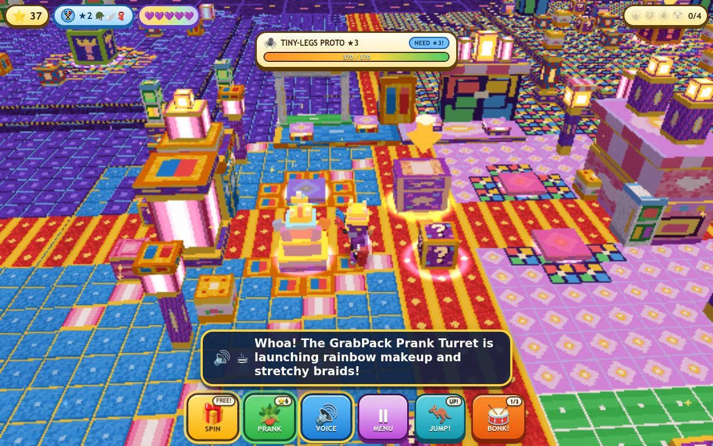

# Playtime Prank RPG 3D: Lily, Giblet & The Smiling Critters' Silly Prank Party! 🫖🎀

**Live Game**: https://kunruiw1991.github.io/playtime-prank-rpg-3d/  
**Inspired By**: [CHAPTER 5: CIVIL WAR! (Poppy Playtime Animation) — Starting at 24:14 (`t=1454s`)](https://www.youtube.com/watch?v=c4AAxXPD8w8&t=1454s)

A kid-friendly, zero-fail **Easy 3D Walking Prank RPG** built with **Three.js r170 (WebGL2)** and **68 Pre-Recorded Neural English Voiceover MP3s (`edge-tts`)**. Walk freely around the multi-room **Playtime Co. Prank Factory & Lily Lovebraids' Lavender Dollhouse**, team up with **Lily Lovebraids**, **Giblet**, and **Chum Chompkins**, upgrade 3-tier Hub Prank Contraptions, spin the Prank Gadget Box, leap with a **Super Mario 3D Jump**, throw returning **Super Mario Odyssey Cappy-Style Prank Gadgets**, and trigger hilarious slapstick pranks on **Miss Gracie**, **Hungry CatNap**, **Tiny-Legs Prototype**, and the **Clown-Makeover Spider-Mech**!

---

## 🎮 Story & Prank Scenes (From `24:14` Onwards)

1. **The Glowing Pink Toy Capsule Pod (`24:14` / `t=1454s`)**:
   - Knock on Miss Gracie's blue factory office door (`"Come on, Miss Gracie, we just want to play with you!"`) and watch the glowing Pink Capsule Tube transform her into **Lily Lovebraids** (`"We're going to have a tea party! I love tea parties and I love crumpets!"`).
2. **Smiling Critters Indoor Soccer Court (`30:49` / `t=1849s`)**:
   - Play soccer with **Hoppy Hopscotch**, **KickinChicken**, **Baba Chops**, **DogDay**, **Huggy Wuggy**, and **Kissy Missy** while Lily blocks goals with her giant stretchy purple braids (`"Blocked by Lily Lovebraids and the crowd goes wild!"`).
3. **Lily's 2-Story Pink & Lavender Dollhouse & CatNap's Fridge (`32:47–38:12` / `t=1967s–2292s`)**:
   - Bake warm Golden Honey Crumpets in Lily's Breezy-Bake Toy Oven and share a giant crumpet with **Hungry CatNap** guarding the stocked factory fridge (`"Want to overthrow a tyrant?"`).
4. **KickinChicken's Makeup Blaster & Prototype's Tiny Legs (`39:11–41:31` / `t=2351s–2491s`)**:
   - Blast the sleeping Prototype with KickinChicken's **Rainbow Makeup Blaster** (`"How do you boys like my makeover?!"`), pop off his mechanical spider legs to reveal his funny tiny normal shoes (`"What the? You had normal legs under all that this whole time!"`), and hijack the **Clown-Makeover Spider-Mech** with Giblet's **Prank Remote** (`52:56`)!

---

## 🕹️ Kid-Friendly Controls & Mechanics

- **Walk & Explore**: Tap or hold anywhere on the factory floor, dollhouse carpet, or soccer pitch to walk with **Lily Lovebraids**, **Giblet**, and **Chum Chompkins** (plus drag horizontally to rotate the 3D camera).
- **Mario Jump (`JUMP!` / `Space`)**: Variable-height 3D arc jump (`v0 = 10.6`, gravity `26.0`), double-jump mid-air boost, squash-and-stretch landing, and Goomba-style stomp on Prank Boxes and Prank Target Bosses.
- **Odyssey Returning Prank Gadget Throw (`THROW!` / `BONK!`)**: Hurl your equipped 3D Prank Gadget forward (`14.5 u/s` spinning at `22 rad/s`), hover-spin at the apex (`0.22s`), and watch it boomerang back to Lily's hand while popping every Prank Box and tickling Bosses along its path.
- **5 Upgradable 3D Prank Gadgets (`SPIN`)**:
  1. `★1` **GrabPack Hand** (Blue & Red Spring Launcher)
  2. `★2` **Purple Braid Whip** (Lily's Stretchy Twin-Braid Whip)
  3. `★3` **Crumpet Teapot** (Breezy-Bake Golden Teapot & Crumpet Launcher)
  4. `★4` **Makeup Blaster** (KickinChicken's Rainbow Blush & Lipstick Cannon)
  5. `★5` **Prank Remote** (Giblet's Prototype Mech Hijack Remote & Magnet Wrench)
- **3-Tier Hub Prank Contraption Stations (`PRANK`)**:
  - **Tier 1**: *Pink Capsule Tea Pod* (`24:14`)
  - **Tier 2**: *Dollhouse Crumpet Oven & Stocked Fridge* (`32:47`)
  - **Tier 3**: *GrabPack & Rainbow Makeup Prank Turret* (`39:11`)

---

## ✅ Automated QA Verification

- **Localization & Audio Audit (`tests/l10n_audit.py`)**: `F13_L10N_PASS` (`68/68` `ffprobe`-verified `edge-tts` MP3s, `2.83 MB`, `0` CJK characters, `0` `speechSynthesis` calls).
- **Multi-Viewport Layout Audit (`tests/layout_audit.py`)**: `F11_LAYOUT_PASS` across all 5 viewports (`1280x800`, `1024x768`, `768x1024`, `844x390`, `390x844`).
- **Simulation Gates (`tests/sim_gates.py`)**: `12/12 PASS` (`F1`–`F12`, including `F10` 20/20 deterministic full-victory bot runs, `F11` Mario 3D Jump & Stomp, and `F12` Odyssey Boomerang Prank Gadget Throw).
- **Master End-to-End Suite (`tests/run_e2e.py`)**: `48/48 PASS` (`E01`–`E48`).
